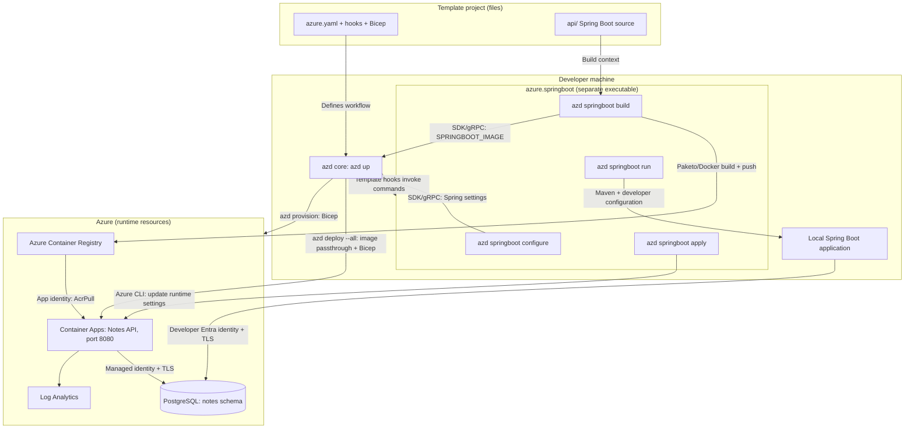

# Spring Boot + PostgreSQL azd template

A prepared Java 21 Spring Boot Notes API deployed to Azure Container Apps, with
passwordless PostgreSQL persistence. The hand-authored [azure.yaml](azure.yaml)
keeps `language: java`; template hooks invoke the separate
[azure.springboot](https://github.com/XiaofeiCao/azure-dev/tree/xiaofeicao-spring-boot-mvp/cli/azd/extensions/azure.springboot)
extension for containerization and configuration. azd owns infrastructure
provisioning and application deployment.

## Architecture



The API reads and writes notes in PostgreSQL. A user-assigned managed identity
authenticates the deployed app to both the registry and database; local execution
uses the developer's identity. The JDBC authentication plugin obtains database
tokens without storing a database password.

The demo API has public, unauthenticated HTTPS ingress. PostgreSQL uses a public
endpoint with individually approved developer IP rules and an explicitly enabled
Azure-services exception, which is not restricted to this app or subscription.

## Provision

```powershell
azd provision
```

[infra/main.bicep](infra/main.bicep) creates a resource group;
[infra/resources.bicep](infra/resources.bicep) provisions PostgreSQL, ACR, the
Container Apps environment/app, Log Analytics, the app identity, and its scoped
`AcrPull` assignment. Initial provisioning uses a placeholder container, not the
Spring Boot application.

The [postprovision hook](scripts/postprovision.ps1) runs database bootstrap to
create the app's Entra-backed SQL role, `notes` schema, and permissions, then calls
`azd springboot configure`. The `azure.springboot` extension maps provisioning outputs into separate
developer and deployed Spring settings in the selected azd environment. Azure
RBAC alone does not grant SQL permissions.

## Deploy

```powershell
azd deploy --all
```

1. [predeploy](scripts/predeploy.ps1) runs `azd package --all`.
   [prepackage](scripts/prepackage.ps1) invokes `azd springboot configure`, then
   `azd springboot build`: the extension builds `api/` with Paketo, pushes to ACR, and saves
   `SPRINGBOOT_IMAGE`.
2. azd reloads the environment and consumes that image through
   `docker.imagePassthrough: true`, without another build. Its Container Apps
   target deploys [infra/api.bicep](infra/api.bicep), using
   [generated settings](infra/api.parameters.json) to configure the application
   revision, port 8080, identity, and startup/liveness/readiness probes.
3. [postdeploy](scripts/postdeploy.ps1) invokes `azd springboot apply` to update runtime
   settings, then waits for database-backed readiness. Container Apps runs the
   application; `azd springboot run` is for local Maven execution, not cloud startup.

`azd up` combines these stages in the template's explicit **provision -> deploy**
workflow. Provisioning comes first because image publication needs the registry.
Integration is explicit template wiring, not automatic project discovery or a
replacement azd framework/hosting provider.

See the [deployment guide](docs/deployment-guide.md) for extension installation,
initialization, configuration, local execution, validation, and cleanup.
